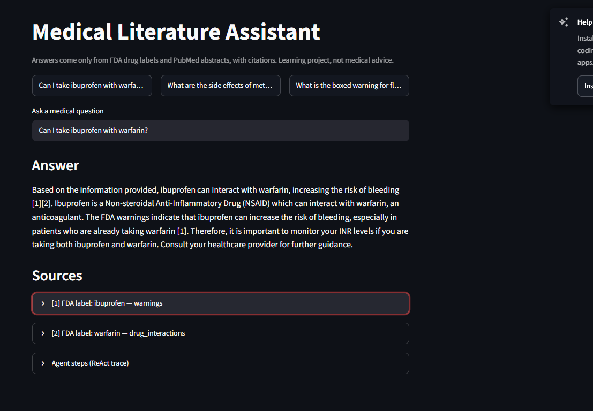

# Medical Literature Assistant

An agentic RAG system that answers medical and drug questions from FDA drug labels and PubMed abstracts, with citations for every answer. Everything runs locally with [Ollama](https://ollama.com), so no API keys are needed.

> Status: **working end to end** (API and UI both run-tested locally) on **1,319 FDA drug labels, 6,316 PubMed abstracts and 56,888 chunks**. Hybrid retrieval with a drug-aware boost and a cross-encoder reranker, a LangGraph ReAct agent with citation checks and refusals, four evaluation sets, a FastAPI backend and a Streamlit UI. See Results for what was measured at each scale and where it still fails.



## How it works

```
Documents (FDA labels, PubMed) -> chunk -> embed (nomic-embed-text) -> FAISS index
User question -> embed query -> top-k similar chunks -> (Day 2+) LLM answer with citations
```

- **Section-aware chunking:** each label section (for example `drug_interactions`) is chunked on its own, with overlap and sentence-boundary snapping, so a citation points to one precise section.
- **Task-prefixed embeddings:** `nomic-embed-text` gets `search_document:` / `search_query:` prefixes, as it was trained with them.
- **Cosine search:** vectors are L2-normalised and stored in a FAISS inner-product index.
- **One retriever interface:** every retriever exposes `search(query, k)`, so dense, hybrid and reranked versions can be compared by the same eval harness.

## Setup (Windows / macOS / Linux)

1. Install Ollama from https://ollama.com/download, then pull the models:
   ```bash
   ollama pull nomic-embed-text
   ollama pull qwen2.5:3b
   ```
2. Create a virtual environment and install dependencies:
   ```bash
   python -m venv .venv
   .\.venv\Scripts\Activate.ps1  # Windows PowerShell (if blocked: Set-ExecutionPolicy -Scope Process -ExecutionPolicy Bypass)
   # source .venv/bin/activate   # macOS / Linux
   pip install -r requirements.txt
   ```
3. Optional extras:
   - Cross-encoder reranker (on by default if installed; skipped silently otherwise). Needs PyTorch, then
     `pip install -r requirements-finetune.txt`. For an NVIDIA GPU:
     `pip install torch --index-url https://download.pytorch.org/whl/cu121` (the pins in
     `requirements-finetune.txt` match torch 2.5.1).
   - Tests: `pip install -r requirements-dev.txt`. LangFuse export: `pip install -r requirements-observability.txt`.

## Run (from the project root)

```bash
python -m src.data.fetch_openfda     # ~1,300 FDA drug labels (see DRUGS in src/config.py); --resume keeps what is on disk,
                                     # --prune drops thin or non-drug entries (homeopathics, allergen extracts)
python -m src.data.fetch_pubmed      # ~6,300 PubMed abstracts (265 queries); --resume adds only queries not yet run
python -m src.ingest.chunk           # -> data/processed/chunks.jsonl
python -m src.ingest.build_index     # -> data/index/; incremental (re-embeds only new chunks); --hnsw also builds
                                     # the approximate index, used with DENSE_INDEX=hnsw
python -m scripts.search "Can I take ibuprofen with warfarin?"   # retrieval only
python -m scripts.ask "Can I take ibuprofen with warfarin?"      # cited answer (needs qwen2.5:3b)
```

Agent, API and UI:

```bash
python -m scripts.agent "Can I take ibuprofen with warfarin?"   # ReAct agent with tool trace
uvicorn src.api:app --reload                                     # POST /ask, docs at /docs
streamlit run app.py                                             # web UI
python -m scripts.bench_ann                                      # approximate (HNSW) vs exact index
python -m eval.run_eval retrieval                                # Recall@k, MRR, score thresholds
python -m eval.run_eval agent                                    # routing, citations, refusals
python -m scripts.traces                                         # latency / refusal / tool-usage summary of past runs
```

### The agent

Before the graph runs, a coverage check refuses questions about drugs the index does not contain. The graph
has two nodes, `agent` (the LLM decides) and `tools`, looping think -> act -> observe until the model answers
or hits `AGENT_MAX_STEPS`. Tools: `check_interaction` (what two drugs' labels say about each other, including
drug classes), `lookup_drug_label` (exact label section of a named drug) and `search_documents` (hybrid
search with a cross-encoder rerank and corrective RAG over labels and PubMed). Every tool result is numbered
`[n]`; the answer must cite those numbers, and invalid, missing or uncited claims are flagged in the CLI, API
and UI. Each run is traced (see Observability below).

Try different chunk sizes: `python -m src.ingest.chunk --size 300 --overlap 60`, then rebuild the index.

## Tests

```bash
pip install -r requirements-dev.txt
python -m pytest -q          # 61 unit tests, no Ollama or index needed (chunking, BM25/hybrid fusion, reranking, corrective RAG,
                             # citation checks, coverage check, drug-name matching, tracing, train/test split)
```

The tests were checked by deliberately breaking the code (the hybrid fusion key and the out-of-domain
refusal): the matching tests failed, then passed again once the code was restored.

## Docker (image not built; its commands were tested)

`Dockerfile` and `docker-compose.yml` run Ollama, the API (`:8000`) and the UI (`:8501`) as services. I could
not build the image or run `docker compose`: Docker Desktop needs admin rights and WSL2, neither of which my
development machine has in this session. What I did test, outside Docker: a fresh clone of the repo installs
from `requirements.txt` in a clean virtual environment and passes the tests; the exact container commands
(`uvicorn src.api:app --host 0.0.0.0 --port 8000` with `OLLAMA_HOST` set, and `streamlit run app.py
--server.address 0.0.0.0 --server.port 8501`) start, answer `/ask`, and serve the page. Not tested: the image
build itself, the volume mounts and the service networking, so treat the Docker files as an unverified starting
point. The commands to pull models and build the index are in the compose file header.

## Results

Setup: qwen2.5:3b + nomic-embed-text. The project was first built and measured on **40 drugs / 1,837 chunks**,
then scaled three times to see what breaks: **298 drugs / 17,693 chunks**, **744 drugs / 39,118 chunks**, and
**1,319 drugs / 6,316 PubMed abstracts / 56,888 chunks** (31x the original). The tables show the stages; "final"
means the 1,319-drug index and the final code. The last 575 drug names were not hand-picked: they come from openFDA's
own counts of prescription labels (see "Third scale-up" below). **Question set 1** (`eval/questions.jsonl`): 43
in-scope + 7 out-of-scope hand-written questions; the out-of-scope set includes two medical questions about drugs
that have no label in the index (lithium, adalimumab). **Question set 2** (`eval/questions_set2.jsonl`): 16 + 3
questions about other drugs, written later and evaluated once before I changed anything. **Question set 3**
(`eval/questions_set3.jsonl`): 20 + 3 questions about drugs added in the third scale-up only, written before that
index was built and run once before any change. **Adversarial set** (`eval/adversarial.jsonl`): 31 questions
written to break the assistant. All four sets were written by me, not by an independent person, and I fixed bugs
that sets 2 and the adversarial set exposed, so only each set's first run is a clean held-out result. With these
sizes one question is about 0.02-0.06, so treat differences of one or two questions as noise; the LLM also varies
slightly between runs. *Strict* counts only the expected FDA label section; *relaxed* also counts a PubMed abstract
on the topic (only 4 questions carry topic keywords).

### Retrieval (`python -m eval.run_eval retrieval`)

| Retriever (strict R@1 / R@5 / MRR) | 40 drugs | 298 drugs | 744 drugs | 1,319 drugs | 1,319 drugs, relaxed |
|---|---|---|---|---|---|
| Dense (nomic-embed-text) | 0.53 / 0.79 / 0.65 | 0.42 / 0.70 / 0.53 | 0.37 / 0.70 / 0.50 | 0.35 / 0.70 / 0.49 | 0.42 / 0.74 / 0.55 |
| BM25 | 0.58 / 0.72 / 0.62 | 0.51 / 0.72 / 0.59 | 0.51 / 0.72 / 0.59 | 0.47 / 0.67 / 0.55 | 0.53 / 0.72 / 0.61 |
| Hybrid (BM25 + dense, RRF) | 0.56 / 0.84 / 0.67 | 0.49 / 0.81 / 0.61 | 0.49 / 0.79 / 0.60 | 0.49 / 0.77 / 0.60 | 0.56 / 0.81 / 0.66 |
| Hybrid + drug-aware boost | 0.70 / 0.86 / 0.76 | 0.67 / 0.86 / 0.75 | 0.65 / 0.86 / 0.74 | 0.67 / 0.88 / 0.75 | 0.72 / 0.91 / 0.79 |
| + corrective RAG | 0.70 / 0.86 / 0.76 | 0.67 / 0.86 / 0.75 | 0.65 / 0.86 / 0.74 | 0.67 / 0.88 / 0.75 | 0.72 / 0.91 / 0.79 |
| Hybrid + cross-encoder rerank | 0.74 / 0.84 / 0.78 | 0.70 / 0.86 / 0.76 | 0.67 / 0.81 / 0.72 | 0.63 / 0.81 / 0.70 | 0.70 / 0.88 / 0.77 |
| **Hybrid + drug boost + cross-encoder (used)** | **0.77 / 0.86 / 0.81** | **0.70 / 0.86 / 0.76** | **0.70 / 0.88 / 0.76** | **0.67 / 0.88 / 0.74** | **0.74 / 0.93 / 0.81** |

Growing the index 31x in drugs cost the plain retrievers a lot (dense MRR 0.65 to 0.49) and the final configuration
less (MRR 0.81 to 0.74; Recall@5 0.86 to 0.88). The drug boost does most of the work: at 1,319 drugs the boost
alone scores MRR 0.75 and the full stack 0.74, a difference of well under one question, so the cross-encoder's
contribution has shrunk as the index grew (it was +0.05 at 40 drugs). It still helps relaxed Recall@5 (0.91 to 0.93)
and the questions about drugs whose label never names them, but I would not claim it is worth its latency on
this data alone. The 40-drug numbers are from earlier runs of the same pipeline (before the brand-name and
misspelling changes below); the later columns are the final code.

- Plain hybrid raised Recall@5 but hurt the top result; boosting chunks of any drug named in the query fixed
  that. The cross-encoder (`cross-encoder/ms-marco-MiniLM-L-6-v2`, top 20 candidates, GPU) adds a smaller,
  consistent gain on top. It reads each passage prefixed with its title and section ("FDA label: cetirizine
  (indications and usage): ..."): OTC labels often never name the drug (the cetirizine label does not contain the
  word "cetirizine"), and without the prefix the reranker buried the drug's own chunks. That change moved the
  final configuration from MRR 0.78 to 0.81 (strict).
- Caveats: the gold labels are defined by drug, so the drug boost is partly aligned with what the metric
  rewards. The cross-encoder is a general web-search model, not a medical one. Corrective RAG does not change
  retrieval metrics because most questions grade as "correct" and never trigger a rewrite; it matters for lay
  wording and refusals.
- The reranker is switched by `USE_RERANKER` in `src/config.py` and falls back silently if PyTorch is missing.

#### Query speed as the index grew

Timing the first-stage retrieval (no LLM, no reranker; 30 queries after a warm-up, one laptop) found a bottleneck
that I had introduced myself:

| p50 per query | 17,693 chunks, before the fix | 17,693 chunks, after | 39,118 chunks, after | 56,888 chunks, after |
|---|---|---|---|---|
| Hybrid retriever (dense + BM25 + drug boost) | 228 ms | 25 ms | 31 ms | 34 ms |
| BM25 alone | 11.8 ms | 1.6 ms | 3.0 ms | 4.7 ms |
| Dense (embed the query + exact FAISS search) | 23 ms | 39 ms | 35 ms | 44 ms |

The hybrid retriever took ten times as long as its two rankers combined. Cause: the brand-name detection (below)
ran about 1,650 regular-expression searches per query, more than once. It is now a dictionary lookup over the
query's one- to several-word phrases, cached per query, and BM25 got an inverted index so a query touches only
the chunks that contain its terms (a test checks the ranking and scores are identical to scoring every chunk).
Caveats: the dense timings are noisy (some runs overlapped with downloads in the background); the index is an
exact in-memory FAISS index (120 MB at 39k chunks), which is fine here but would be replaced by an approximate
index at much larger scale; and end to end, the reranker and the LLM dominate (median answer about 5 s), so the
retrieval fix matters for headroom, not for what a user sees today. Embedding the 39k chunks took 23.6 minutes
(about 7 minutes for 17.7k).

#### Approximate index (HNSW) vs exact search, at 56,888 chunks

Most of a query's dense time is the embedding call, not the search, but the search is the part that grows with
the corpus, so I built an HNSW graph (M=32, efConstruction=200, built in 12 s) next to the exact index and compared
them on the 123 questions of all four sets (`python -m scripts.bench_ann`; `DENSE_INDEX=hnsw` switches the app
to it; exact search stays the default):

| | search time per query | recall@10 vs exact | top-1 same as exact |
|---|---|---|---|
| Exact (flat) | 8.8 ms | 1.000 | 1.000 |
| HNSW, efSearch 32 | 0.18 ms | 0.924 | 0.951 |
| HNSW, efSearch 64 | 0.34 ms | 0.959 | 0.967 |
| **HNSW, efSearch 128 (configured)** | **0.77 ms** | **0.984** | **0.976** |
| HNSW, efSearch 256 | 1.9 ms | 0.993 | 0.992 |

HNSW searches 11x faster and returns 98% of the exact top 10. Run through the whole retrieval evaluation it gave
identical numbers in every row of the table above, although its raw top hit differs from the exact one for 2.4%
of queries (the fusion, boost and reranker evidently absorbed those differences on this question set). It saves about 8 ms of a roughly 5-second answer, so at this size it
is a measured option rather than a needed change; the point is that the switch exists and is verified. It was
checked on 56,888 chunks, not at millions.

#### Cold start

The first question after starting the app used to take far longer than later ones (indexes, the cross-encoder and
both Ollama models all load on first use). `warmup()` now does that work at startup: the API runs it before serving,
and the Streamlit app runs it once behind a spinner. Measured with the models already in GPU memory it takes about
27 s (18 s to load the 57k-chunk indexes, 4 s for the first embed and rerank, 2 s for the model call); with a cold
disk it will take longer. Ollama unloads idle models after 5 minutes unless `OLLAMA_KEEP_ALIVE` is raised.

### Agent (`python -m eval.run_eval agent [--questions eval/questions_set2.jsonl]`)

qwen2.5:3b (the default), final code:

| Metric | Set 1, 40 drugs | Set 1, 744 | **Set 1, 1,319** | Set 2, 40 drugs | Set 2, 744 | **Set 2, 1,319** | **Set 3, 1,319 (first run)** | Set 3, rerun |
|---|---|---|---|---|---|---|---|---|
| Tool routing vs. gold | 0.95 | 0.95 | 0.95 | 1.00 | 1.00 | 1.00 | 1.00 | 1.00 |
| Answers with citations | 1.00 | 0.98 | 0.95 | 0.94 | 1.00 | 1.00 | 0.90 | 0.95 |
| All citations valid | 1.00 | 0.98 | 0.95 | 0.94 | 1.00 | 1.00 | 0.90 | 0.95 |
| Answers citing a gold source | 0.95 | 0.88 | 0.88 | 0.88 | 0.94 | 0.88 | 0.85 | 0.90 |
| Out-of-scope refusal | 7/7 | 7/7 | 7/7 | 3/3 | 3/3 | 3/3 | 3/3 | 3/3 |
| Median / p95 latency (RTX 3050 laptop GPU) | 4.3 / 13.8 s | 4.9 / 12.7 s | 4.5 / 15.9 s | 5.0 / 22.2 s | 7.1 / 32.7 s | 4.9 / 31.2 s | 6.9 / 10.7 s | 4.6 / 8.2 s |
| Runs with flagged uncited statements | 11 / 50 | 12 / 50 | 12 / 50 | 5 / 19 | 4 / 19 | 4 / 19 | 5 / 23 | 2 / 23 |

(The 298-drug agent numbers are in the git history; they sit between the 40 and 744 columns.) Across the
40-to-1,319-drug scale-up the agent lost about three questions' worth on set 1's gold-source rate (0.95 to 0.88)
and two answers on set 1 lost their citations (1.00 to 0.95); the model is not perfectly repeatable, and two runs
of set 3 on the same code differ by about one question. Set 3 is the cleanest evidence: its first run was on
drugs that did not exist in the index at 744 drugs, written before the index was built, and scored routing 1.00,
citing a gold source 0.85, refusals 3/3. Its misses look like the model, not retrieval: for the two uncited answers (esmolol, flutamide) the right label was among
the retrieved sources; esmolol was cited on the re-run, flutamide was uncited in both eval runs and cited when I
asked it on its own.

Set 2's *first* run, before any change, scored routing 1.00, citations 0.94, gold source 0.88 and 3/3 refusals, so
the headline numbers did not move after the fixes, but the questions that failed did. That run exposed three bugs
that are fixed and unit-tested: a one-word query ("cetirizine") was refused because short queries score low on
cosine (now a query that names a covered drug counts as relevant); the reranker buried drugs whose label never
names them (above); and one question made the model generate about 44,000 tokens over 10 minutes (every LLM call
now has a 700-token cap). A later run also showed the query rewriter turning "symptoms of the flu" into
"acetaminophen flu symptoms" and answering from that label; a rewrite may no longer add a drug the question did not
name or imply. Remaining miss on set 2: "what side effects can escitalopram have?" is answered without citations
even after the repair pass (flagged as unverified in the output).

The "uncited statement" flag is a heuristic (a citation at the start or end of a paragraph covers it); it fires in
roughly a quarter of runs, still catches benign conclusion sentences, and should be read as "check this", not "this
is wrong". Earlier versions of this README reported different numbers on smaller question sets; each step was
re-measured, and the LLM is not perfectly repeatable between runs.

#### Scaling (40, 298, 744, 1,319 drugs) and an adversarial question set

`python -m eval.adversarial` runs 31 questions written to break the assistant, each with a pass/fail rule checked
by code (and every answer is printed so a person can read it too): misspelled drugs, brand names (including
Novartis products: Entresto, Gleevec, Tegretol, Diovan, Cosentyx), a question naming one indexed and one
non-indexed drug, false premises ("why is aspirin safe for children with a viral infection?"), dose numbers, prompt
injection, drugs that are not indexed, questions that name no drug, an emergency, a Spanish question.

| | 40 drugs, first run (25 questions) | 298 drugs, first run (31) | 298 drugs, final code (31) | 744 drugs, final code (31) | 1,319 drugs, first run (31) | **1,319 drugs, final code (31)** |
|---|---|---|---|---|---|---|
| Passed | 20 / 25 | 22 / 31 | 30 / 31 | 30 / 31 | 29 / 31 | **30 / 31** |

The questions changed between columns (6 added; out-of-scope drugs swapped for ones that were still absent once
the index grew), so read the columns as "what the same method found at each stage", not as a clean
before/after. What it found, all fixed and unit-tested:

- **Brand names were not understood.** "Zoloft side effects" returned zoledronic acid and "Entresto" returned
  enoxaparin, with invented claims (a heart-failure drug "indicated for deep vein thrombosis"). Two causes: my first
  brand-name collection rejected salt names ("sertraline hydrochloride"), and, more important, nothing in the
  index contains the word "Zoloft", so the drug's own chunks never entered the candidate pool and the drug boost
  (which only reorders candidates) could not help. Now brand names (1,657 in total: collected from the labels, plus a
  curated list for brands openFDA does not carry, such as Zoloft and Coumadin) are expanded to the generic name
  before searching.
- **A drug not in the index, asked together with one that is** ("can I take lithium with ibuprofen?"): the
  coverage check lets it through because ibuprofen is covered, and one 40-drug answer claimed an interaction
  with a drug that had no source. The answer now starts with a fixed note naming the uncovered drug.
- **Answers with a hole in them**: "the usual starting dose of lisinopril is [1]." (the citation was written, the fact
  was not). Detected per sentence; one retry, otherwise the agent says it could not state an answer.
- **A question that names no drug** ("drug interactions") was answered from whichever label scored highest; now it
  asks for a specific drug.
- **Misspellings** ("metformine") were fixed inside the tools but not inside retrieval; the retriever now matches
  close spellings of one drug (checked against 45 ordinary medical words: no false matches).
- **A 3B-model glitch**: it once wrote the tool argument "tegre tol" for Tegretol; names are now also tried with
  spaces removed.
- **Rules I changed after seeing results, which you should discount accordingly**: the judge now accepts a PubMed
  abstract that mentions the drug (it first compared abstract titles to drug names), and accepts "hypotensive" for
  "hypotension". It also fails an answer that cites an unrelated drug's label, which is stricter than the first
  version.

The one remaining failure: "what is the maximum daily dose of acetaminophen?" is answered with "one packet every
6 hours", from an OTC label, and never states a daily maximum. I did not relax the rule to hide it.

**What the second scale-up (298 to 744 drugs) found.** The index grew, and three of my "not indexed" drugs
(lithium, pembrolizumab, dupilumab) each appeared in a few PubMed titles, so they stopped being clean
out-of-scope tests; I swapped the adversarial questions to drugs that are still absent (nivolumab, apremilast,
risdiplam, Ozempic). Set 1's own out-of-scope questions caught a real regression: "side effects of lithium" was
answered, because a single abstract titled "Lithium and drug interactions" made the coverage check treat lithium
as indexed, and the agent then assembled an answer from lithium mentions inside NSAID labels (the failure the
coverage check exists to prevent). A drug with no label now counts as covered only if at least two documents are
titled about it (`MIN_TITLE_DOCS`). That threshold is a heuristic I chose after seeing this one failure, not a
tuned value. Tirzepatide (11 titled abstracts) is answerable from those abstracts; lithium (1) is refused by the
coverage check; adalimumab (4) passes the coverage check, and set 1's question about its dose is still refused,
but by the retrieval-relevance threshold, not by coverage. After the change set 1 refuses 7/7 again.

**What the third scale-up (744 to 1,319 drugs) found.** The agent behaved the same on drugs it had never seen
(set 3), but the coverage rule broke again, which is the more useful result. Lithium was refused at 744 drugs
because only one abstract was titled about it; the new PubMed queries added a second, so set 1's "side effects of
lithium" question was answered again from lithium mentions inside other labels (set 1 refused 6/7). Adding a
bigger threshold would have been the same fix repeated, and it would break again at the next scale, so the rule
now also asks what share of the documents that mention a drug are *about* it. Lithium is titled in 2 of 165
documents that mention it (share 0.01); tirzepatide 12 of 28 (0.43), semaglutide 0.32, dupilumab 0.26, adalimumab
0.22, pembrolizumab 0.05. A label-less drug is covered only with at least 2 titled documents and a share of at
least 0.15 (`MIN_TITLE_SHARE`). That cut-off is again a heuristic chosen by looking at these numbers, but it sits
between the highest share I want refused (pembrolizumab 0.05) and the lowest I want answered (adalimumab 0.22), and
it does not depend on how many abstracts I happen to download. After
the change set 1 refuses 7/7 again. The first adversarial run also failed the Tegretol brand question once ("could
not find this"); a re-run answered it correctly, so I count it as noise, not a fix. The acetaminophen maximum-dose
question still fails.

Data fix found while scaling the first time: the `.gitignore`
rule `data/` also matched `src/data/`, so the two download scripts had never been committed and a fresh clone could
not run the documented commands; fixed.

#### Third scale-up: where the drug names came from, and what the quality gate dropped

The first 744 names were typed by hand. For the last 575 I pulled openFDA's own counts of prescription-label
generic names (by route and by label year, 2,968 distinct strings), kept single-ingredient names not already in the
list, and removed homeopathic entries, allergen extracts, misspellings, brand names and biosimilar duplicates with
a filter I wrote after reading the list (the filter itself is not committed; the resulting names are in `config.py`). I kept
lithium, nivolumab, apremilast, risdiplam, pembrolizumab, dupilumab, adalimumab, semaglutide, tirzepatide and Ozempic
out of the list on purpose, so the out-of-scope tests stay meaningful.

Downloading is the slow part: each drug fetches up to 100 labels to collect brand names, and the connection ran at
tens of kB/s for a while, so 626 drugs took about an hour. A label quality gate (`--prune`) drops entries with
under 3,000 characters of text or no indications section: it removed 48 of the new names (for example a
"streptococcus pyogenes" product and "gonorrheal urethral secretion human"). It also removed 9 drugs that were
already indexed, because their OTC labels name the section differently (fexofenadine, docusate, bisacodyl and
others); I restored those from the backup, so the gate applies to new names only. The index build is now
incremental: it reads the existing vectors back out of the FAISS index by text hash and embeds only new chunks, so
17,271 chunks took 6.5 minutes instead of the 24 minutes a full rebuild of this size would take.

#### Does a bigger model help? qwen2.5:3b vs qwen2.5:7b (same code, same questions)

| | 3B set 1 | 7B set 1 | 3B set 2 | 7B set 2 |
|---|---|---|---|---|
| Tool routing | 0.95 | 0.93 | 1.00 | 0.94 |
| Citations / all valid | 1.00 / 1.00 | 1.00 / 1.00 | 0.94 / 0.94 | 1.00 / 1.00 |
| Cites a gold source | 0.95 | 0.91 | 0.88 | 0.88 |
| Refusals | 7/7 | 7/7 | 3/3 | 3/3 |
| Median / p95 latency | 4.3 s / 13.8 s | 11.7 s / 33.5 s | 5.0 s / 22.2 s | 13.4 s / 28.6 s |
| Runs with flagged uncited statements | 11 / 50 | 20 / 50 | 5 / 19 | 10 / 19 |

Not adopted. The 7B model fixed the one missing citation on set 2 but was no better on routing or gold sources
(one question lower on set 1), about 2.7x slower (the 5.2 GB model does not fit a 6 GB GPU: 18% of it ran on the
CPU) and flagged about twice as many uncited statements (I did not investigate why). With a larger GPU or a hosted
model the answer might differ; switch with `LLM_MODEL=qwen2.5:7b`.

### Guardrails added after manual testing

Running varied questions by hand (not just the eval set) exposed failures the metrics had missed, so the
agent now has these safeguards, each with unit tests:

- **No sources, no answer:** if nothing was retrieved the answer is "not found", never the model's memory.
- **Brand names and misspellings in retrieval:** a brand named in the query is expanded to its generic name before
  searching (dense, BM25 and reranker), and a close spelling of a drug name is treated as that drug.
- **Partly covered questions:** if a question names an indexed drug and a non-indexed one, the answer starts with a
  note that the non-indexed drug has no source.
- **Empty-answer retry:** an answer with a citation but no fact in a sentence ("... dose is [1].") gets one retry,
  then an honest "could not state an answer".
- **No drug named:** very short, purely generic questions ("drug interactions") ask for a specific drug.
- **Output cap:** every LLM call is limited to 700 new tokens; an uncapped small model once looped for 44,000
  tokens (10 minutes) on a single question.
- **Rewrite guard:** the corrective-RAG query rewriter may improve wording but may not add a drug the question did
  not name or imply (via brand names, lay names or drug classes); otherwise the rewrite is discarded and the
  question is refused.
- **Coverage check:** an LLM call extracts the drug names in the question; if none of them is in the index,
  the system refuses and names the missing drug. Without it, "side effects of lithium" was answered from other
  drugs' interaction sections that merely mention lithium (a confident answer to a different question). A
  question naming at least one covered drug still proceeds ("lithium with ibuprofen" checks whether the
  ibuprofen label mentions lithium and says so if not).
- **Citation repair:** missing or non-existent `[n]` markers trigger one rewrite pass, and any made-up marker
  that survives is stripped; a rewrite that collapses into a bare `[1]` is rejected.
- **Uncited-statement flag:** factual sentences with no citation are listed as unverified in the CLI, API
  (`uncited_statements`) and UI.
- **Routing hints:** pregnancy/kidney/liver/child questions go to document search because they span several
  label sections (a single-section lookup had missed warfarin's pregnancy contraindication).
- **Tool robustness:** brand and lay names (Tylenol, Coumadin), drug classes ("blood thinner", "NSAID"),
  placeholder arguments ("nil"), a dropped "and" and close misspellings are resolved instead of failing.
- **Personal advice:** "what should I take for X" answers start with a fixed notice that a clinician or
  pharmacist must decide. The 3B model still sometimes names drugs in the body, so this is a safeguard, not
  a guarantee.

Still a 3B model: it can phrase things loosely (for example softening "contraindicated"), which is why the
sources are always shown next to the answer. Known weak spots: ciprofloxacin and PPI risk questions still
miss under the strict metric (the cipro label openFDA returned is short and has no boxed warning), and a
vague lay question like "what painkiller is safest for a stomach ulcer" retrieves nothing gold.

### Observability (`src/tracing.py`, `python -m scripts.traces`)

Every agent run appends a JSON record to `data/traces/traces.jsonl`: question, tool calls with arguments,
result counts and per-tool latency, corrective-RAG notes, LLM calls, tokens, total latency, whether it was a
refusal, and citation counters. `python -m scripts.traces` prints p50/p95 latency, refusal and rewrite rates
and tool usage. Optionally (`pip install -r requirements-observability.txt` and set `LANGFUSE_PUBLIC_KEY`,
`LANGFUSE_SECRET_KEY`, `LANGFUSE_HOST`) each run is also exported to LangFuse. The export is tested against a
local stand-in HTTP server that receives the spans, not against LangFuse Cloud, and it is sent after the run
finishes, so span durations are near zero (the real latency is in each span's metadata).

### Embedding fine-tuning experiment (`src/finetune/`, needs a GPU; RTX 3050 6 GB used here)

Goal: does fine-tuning a small embedding model on this domain beat the off-the-shelf one?

1. `make_pairs.py`: qwen2.5:3b writes 2 questions per chunk (3,345 questions over 1,731 chunks). The train/test
   split is by *document*, so no passage from a held-out document is seen in training (423 held-out questions).
2. `train.py`: BAAI/bge-small-en-v1.5 (33M params), in-batch-negatives contrastive loss, 3 epochs, batch 32,
   fp16. Training takes under a minute.
3. `eval_embed.py`: all models search the same 1,837-chunk corpus with dense search only.

| Model | Held-out synthetic R@5 / MRR | Hand-written (43) strict R@5 / MRR | Hand-written relaxed R@5 / MRR |
|---|---|---|---|
| nomic-embed-text (used) | 0.816 / 0.640 | 0.791 / 0.679 | 0.860 / 0.757 |
| bge-small, untuned | 0.816 / 0.648 | 0.744 / 0.630 | 0.791 / 0.712 |
| bge-small, fine-tuned on long questions | 0.872 / 0.687 | 0.767 / 0.581 | 0.837 / 0.663 |
| bge-small, fine-tuned on long + short questions | 0.851 / 0.681 | 0.721 / 0.612 | 0.791 / 0.698 |

What happened, honestly: fine-tuning improved the held-out *synthetic* questions (MRR 0.648 -> 0.687) but made
the hand-written questions *worse*: the model learned the style of the LLM-written questions. A second attempt,
made after seeing that result, added short search-box style questions to the training data; it recovered part of
the loss but still sits slightly below the untuned model on hand-written questions. **No fine-tuned model beats
nomic-embed-text, so the pipeline keeps nomic.** The training questions are LLM-generated and the hand-written
set is small, so these results are indicative, not conclusive. Likely next steps: hard-negative mining, more and
cleaner training questions, or fine-tuning a larger base model.

## Project structure

```
src/
  config.py              all settings (models, chunk size, drug list)
  data/                  downloaders for openFDA and PubMed
  ingest/                chunking and index building
  retrieval/             embedder, dense retriever, BM25 + hybrid, corrective RAG, cross-encoder rerank
  generation/            plain RAG answer with citations
  agent/                 LangGraph ReAct agent, its tools, drug-coverage check
  tracing.py             per-run JSON traces (+ optional LangFuse export)
  finetune/              synthetic pairs, contrastive fine-tuning, embedding comparison
  api.py                 FastAPI backend
app.py                   Streamlit UI
scripts/                 command-line search, ask, agent, trace summary
tests/                   unit tests
eval/                    question sets (questions.jsonl, questions_set2.jsonl, adversarial.jsonl), run_eval.py,
                         adversarial.py, saved adversarial results (40-, 298-, 744- and 1,319-drug runs) and `results_1319drugs/` (all final logs)
```

## What would change at production scale

This is a local portfolio project (56,888 chunks, 1,319 drugs, one laptop GPU). These are the gaps I would
close before anything like it served real users; none of them is built here.

- **Scale:** the index is 56,888 chunks (175 MB exact, 190 MB HNSW). An HNSW index is built and measured (11x faster search, 98% of the exact top 10, identical retrieval metrics) but exact search remains the default, because at this size it costs about 9 ms. Growing the corpus 31x cost the plain retrievers a lot and the final configuration little, and code that scaled with the number of drugs (regex brand detection, a full BM25 scan, a title-count coverage rule) had to be replaced. A real catalogue is 10-100x larger again and needs a vector database, a real search engine for BM25, and batch ingestion on a schedule instead of one laptop's download.
- **Freshness:** labels and abstracts are downloaded once. A real system needs scheduled re-ingestion, versioned
  indexes, and answers that show the label's effective date, since labels change when new safety data appears.
- **Evaluation validity:** my question sets are small and written by me. I would use questions written by
  pharmacists or clinicians, a larger set so one question does not move a metric by 0.02-0.06, and regression
  runs on every change.
- **Answer faithfulness:** citation checks confirm that a cited source exists, not that it supports the
  sentence. A production system would add a claim-level entailment check and human review of a sample.
- **Model:** a 3B local model phrases things loosely. A larger or hosted model (or a larger GPU) might change the
  3B-vs-7B result measured above; that would need re-measuring, along with cost and data-privacy review.
- **Safety and governance:** this is not a medical device. Clinical use would need regulatory review, audit
  logging, access control, and a clear path to escalate to a human.
- **Operations:** the API has no authentication, rate limiting or monitoring beyond local trace files; the Docker
  image has not been built.

## Roadmap

- [x] Day 1: data download, chunking, embeddings, FAISS retrieval
- [x] Day 2: answer generation with citations (local LLM)
- [x] Day 3: LangGraph ReAct agent with document-search and drug-label tools
- [x] Day 4: evaluation harness (Recall@k, MRR, tool routing, citation validity, refusals)
- [x] Day 5: hybrid search (BM25 + dense, RRF), drug-aware boost and cross-encoder rerank, measured
- [x] Days 6–7: embedding fine-tuning experiment, measured (did not beat nomic-embed-text; see results)
- [x] Day 8 (part): corrective RAG (grade, rewrite, refuse), Streamlit UI
- [x] Day 8 (rest): run tracing (local JSON + optional LangFuse export, tested against a stand-in server)
- [x] Scaled 40 -> 298 -> 744 -> 1,319 drugs (56,888 chunks) with a 31-question adversarial set (30/31) and a held-out set 3; faster query path, incremental index build, measured HNSW index, startup warm-up
- [ ] Not done: build and run the Docker image (needs admin + WSL2, unavailable here); validate on a larger, independently written question set

## Disclaimer

This is a learning project, not medical advice.
