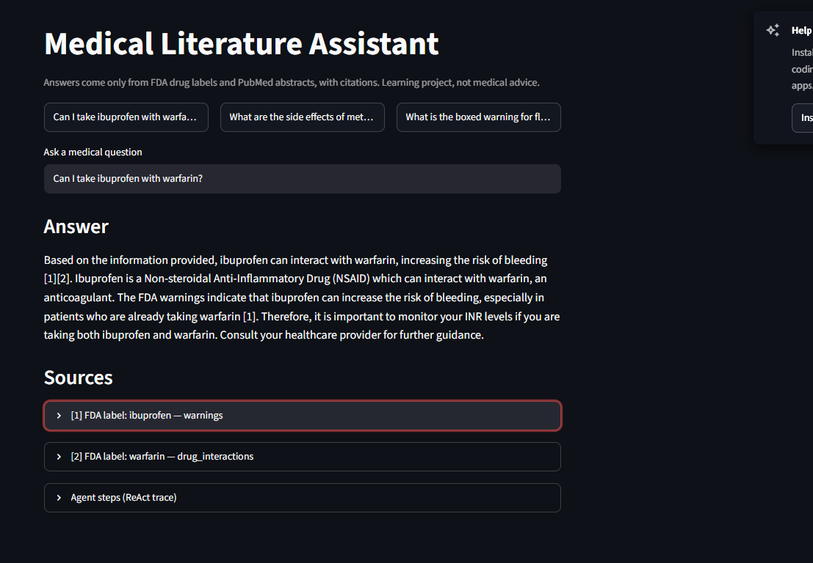

# Medical Literature Assistant

An agentic RAG system that answers medical and drug questions from FDA drug labels and PubMed abstracts, with citations for every answer. Everything runs locally with [Ollama](https://ollama.com), so no API keys are needed.

> Status: **working end to end** (API and UI both run-tested locally). Retrieval, cited answers, a LangGraph ReAct agent, an eval harness, a FastAPI backend and a Streamlit UI. Hybrid search, reranking and embedding fine-tuning are next (see roadmap).



## How it works

```
Documents (FDA labels, PubMed) -> chunk -> embed (nomic-embed-text) -> FAISS index
User question -> embed query -> top-k similar chunks -> (Day 2+) LLM answer with citations
```

- **Section-aware chunking:** each label section (for example `drug_interactions`) is chunked on its own, with overlap and sentence-boundary snapping, so a citation points to one precise section.
- **Task-prefixed embeddings:** `nomic-embed-text` gets `search_document:` / `search_query:` prefixes, as it was trained with them.
- **Cosine search:** vectors are L2-normalised and stored in a FAISS inner-product index.
- **One retriever interface:** every retriever exposes `search(query, k)`, so dense, hybrid and reranked versions can be compared by the same eval harness.

## Setup (Windows / macOS / Linux)

1. Install Ollama from https://ollama.com/download, then pull the models:
   ```bash
   ollama pull nomic-embed-text
   ollama pull qwen2.5:3b
   ```
2. Create a virtual environment and install dependencies:
   ```bash
   python -m venv .venv
   .\.venv\Scripts\Activate.ps1  # Windows PowerShell (if blocked: Set-ExecutionPolicy -Scope Process -ExecutionPolicy Bypass)
   # source .venv/bin/activate   # macOS / Linux
   pip install -r requirements.txt
   ```
3. Optional extras:
   - Cross-encoder reranker (on by default if installed; skipped silently otherwise). Needs PyTorch, then
     `pip install -r requirements-finetune.txt`. For an NVIDIA GPU:
     `pip install torch --index-url https://download.pytorch.org/whl/cu121` (the pins in
     `requirements-finetune.txt` match torch 2.5.1).
   - Tests: `pip install -r requirements-dev.txt`. LangFuse export: `pip install -r requirements-observability.txt`.

## Run (from the project root)

```bash
python -m src.data.fetch_openfda     # ~40 FDA drug labels
python -m src.data.fetch_pubmed      # ~200 PubMed abstracts
python -m src.ingest.chunk           # -> data/processed/chunks.jsonl
python -m src.ingest.build_index     # -> data/index/
python -m scripts.search "Can I take ibuprofen with warfarin?"   # retrieval only
python -m scripts.ask "Can I take ibuprofen with warfarin?"      # cited answer (needs qwen2.5:3b)
```

Agent, API and UI:

```bash
python -m scripts.agent "Can I take ibuprofen with warfarin?"   # ReAct agent with tool trace
uvicorn src.api:app --reload                                     # POST /ask, docs at /docs
streamlit run app.py                                             # web UI
python -m eval.run_eval retrieval                                # Recall@k, MRR, score thresholds
python -m eval.run_eval agent                                    # routing, citations, refusals
python -m scripts.traces                                         # latency / refusal / tool-usage summary of past runs
```

### The agent

Before the graph runs, a coverage check refuses questions about drugs the index does not contain. The graph
has two nodes, `agent` (the LLM decides) and `tools`, looping think -> act -> observe until the model answers
or hits `AGENT_MAX_STEPS`. Tools: `check_interaction` (what two drugs' labels say about each other, including
drug classes), `lookup_drug_label` (exact label section of a named drug) and `search_documents` (hybrid
search with a cross-encoder rerank and corrective RAG over labels and PubMed). Every tool result is numbered
`[n]`; the answer must cite those numbers, and invalid, missing or uncited claims are flagged in the CLI, API
and UI. Each run is traced (see Observability below).

Try different chunk sizes: `python -m src.ingest.chunk --size 300 --overlap 60`, then rebuild the index.

## Tests

```bash
pip install -r requirements-dev.txt
python -m pytest -q          # 46 unit tests, no Ollama or index needed (chunking, BM25/hybrid fusion, reranking, corrective RAG,
                             # citation checks, coverage check, drug-name matching, tracing, train/test split)
```

The tests were checked by deliberately breaking the code (the hybrid fusion key and the out-of-domain
refusal): the matching tests failed, then passed again once the code was restored.

## Docker (image not built; its commands were tested)

`Dockerfile` and `docker-compose.yml` run Ollama, the API (`:8000`) and the UI (`:8501`) as services. I could
not build the image or run `docker compose`: Docker Desktop needs admin rights and WSL2, neither of which my
development machine has in this session. What I did test, outside Docker: a fresh clone of the repo installs
from `requirements.txt` in a clean virtual environment and passes the tests; the exact container commands
(`uvicorn src.api:app --host 0.0.0.0 --port 8000` with `OLLAMA_HOST` set, and `streamlit run app.py
--server.address 0.0.0.0 --server.port 8501`) start, answer `/ask`, and serve the page. Not tested: the image
build itself, the volume mounts and the service networking, so treat the Docker files as an unverified starting
point. The commands to pull models and build the index are in the compose file header.

## Results

Setup: qwen2.5:3b + nomic-embed-text, 1,837 chunks. **Question set 1** (`eval/questions.jsonl`): 43 in-scope + 7
out-of-scope hand-written questions; the out-of-scope set includes two medical questions about drugs that are
not in the index (lithium, adalimumab). **Question set 2** (`eval/questions_set2.jsonl`): 16 + 3 questions about
other drugs, written later and evaluated once before I changed anything. Both sets were written by me, not by an
independent person, and I fixed bugs that set 2 exposed, so only set 2's first run is a clean held-out result
(below). With these sizes one question is about 0.02-0.06, so treat differences of one or two questions as noise;
the LLM also varies slightly between runs. *Strict* counts only the expected FDA label section; *relaxed* also
counts a PubMed abstract on the topic (only 4 questions carry topic keywords).

### Retrieval (`python -m eval.run_eval retrieval`)

| Retriever | Recall@1 strict / relaxed | Recall@5 strict / relaxed | MRR strict / relaxed |
|---|---|---|---|
| Dense (nomic-embed-text) | 0.53 / 0.63 | 0.79 / 0.86 | 0.65 / 0.73 |
| BM25 | 0.58 / 0.67 | 0.72 / 0.79 | 0.62 / 0.71 |
| Hybrid (BM25 + dense, RRF) | 0.56 / 0.65 | 0.84 / 0.91 | 0.67 / 0.76 |
| Hybrid + drug-aware boost | 0.70 / 0.74 | 0.86 / 0.91 | 0.76 / 0.81 |
| + corrective RAG | 0.70 / 0.74 | 0.86 / 0.91 | 0.76 / 0.81 |
| Hybrid + cross-encoder rerank | 0.74 / 0.81 | 0.84 / 0.91 | 0.78 / 0.86 |
| **Hybrid + drug boost + cross-encoder (used)** | **0.77 / 0.84** | **0.86 / 0.93** | **0.81 / 0.88** |

- Plain hybrid raised Recall@5 but hurt the top result; boosting chunks of any drug named in the query fixed
  that. The cross-encoder (`cross-encoder/ms-marco-MiniLM-L-6-v2`, top 20 candidates, GPU) adds a smaller,
  consistent gain on top. It reads each passage prefixed with its title and section ("FDA label: cetirizine
  (indications and usage): ..."): OTC labels often never name the drug (the cetirizine label does not contain the
  word "cetirizine"), and without the prefix the reranker buried the drug's own chunks. That change moved the
  final configuration from MRR 0.78 to 0.81 (strict).
- Caveats: the gold labels are defined by drug, so the drug boost is partly aligned with what the metric
  rewards. The cross-encoder is a general web-search model, not a medical one. Corrective RAG does not change
  retrieval metrics because most questions grade as "correct" and never trigger a rewrite; it matters for lay
  wording and refusals.
- The reranker is switched by `USE_RERANKER` in `src/config.py` and falls back silently if PyTorch is missing.

### Agent (`python -m eval.run_eval agent [--questions eval/questions_set2.jsonl]`)

qwen2.5:3b (the default), final code:

| Metric | Set 1 (43 + 7) | Set 2 (16 + 3, after fixes) |
|---|---|---|
| Tool routing vs. gold | 0.95 | 1.00 |
| Answers with citations | 1.00 | 0.94 |
| All citations valid | 1.00 | 0.94 |
| Answers citing a gold source | 0.95 | 0.88 |
| Out-of-scope refusal | 7/7 | 3/3 |
| Median / p95 latency (RTX 3050 laptop GPU) | 4.3 s / 13.8 s | 5.0 s / 22.2 s |

Set 2's *first* run, before any change, scored routing 1.00, citations 0.94, gold source 0.88 and 3/3 refusals, so
the headline numbers did not move after the fixes, but the questions that failed did. That run exposed three bugs
that are fixed and unit-tested: a one-word query ("cetirizine") was refused because short queries score low on
cosine (now a query that names a covered drug counts as relevant); the reranker buried drugs whose label never
names them (above); and one question made the model generate about 44,000 tokens over 10 minutes (every LLM call
now has a 700-token cap). A later run also showed the query rewriter turning "symptoms of the flu" into
"acetaminophen flu symptoms" and answering from that label; a rewrite may no longer add a drug the question did not
name or imply. Remaining miss on set 2: "what side effects can escitalopram have?" is answered without citations
even after the repair pass (flagged as unverified in the output).

The "uncited statement" flag is a heuristic (a citation at the start or end of a paragraph covers it); it fires in
roughly a quarter of runs, still catches benign conclusion sentences, and should be read as "check this", not "this
is wrong". Earlier versions of this README reported different numbers on smaller question sets; each step was
re-measured, and the LLM is not perfectly repeatable between runs.

#### Does a bigger model help? qwen2.5:3b vs qwen2.5:7b (same code, same questions)

| | 3B set 1 | 7B set 1 | 3B set 2 | 7B set 2 |
|---|---|---|---|---|
| Tool routing | 0.95 | 0.93 | 1.00 | 0.94 |
| Citations / all valid | 1.00 / 1.00 | 1.00 / 1.00 | 0.94 / 0.94 | 1.00 / 1.00 |
| Cites a gold source | 0.95 | 0.91 | 0.88 | 0.88 |
| Refusals | 7/7 | 7/7 | 3/3 | 3/3 |
| Median / p95 latency | 4.3 s / 13.8 s | 11.7 s / 33.5 s | 5.0 s / 22.2 s | 13.4 s / 28.6 s |
| Runs with flagged uncited statements | 11 / 50 | 20 / 50 | 5 / 19 | 10 / 19 |

Not adopted. The 7B model fixed the one missing citation on set 2 but was no better on routing or gold sources
(one question lower on set 1), about 2.7x slower (the 5.2 GB model does not fit a 6 GB GPU: 18% of it ran on the
CPU) and flagged about twice as many uncited statements (I did not investigate why). With a larger GPU or a hosted
model the answer might differ; switch with `LLM_MODEL=qwen2.5:7b`.

### Guardrails added after manual testing

Running varied questions by hand (not just the eval set) exposed failures the metrics had missed, so the
agent now has these safeguards, each with unit tests:

- **No sources, no answer:** if nothing was retrieved the answer is "not found", never the model's memory.
- **Output cap:** every LLM call is limited to 700 new tokens; an uncapped small model once looped for 44,000
  tokens (10 minutes) on a single question.
- **Rewrite guard:** the corrective-RAG query rewriter may improve wording but may not add a drug the question did
  not name or imply (via brand names, lay names or drug classes); otherwise the rewrite is discarded and the
  question is refused.
- **Coverage check:** an LLM call extracts the drug names in the question; if none of them is in the index,
  the system refuses and names the missing drug. Without it, "side effects of lithium" was answered from other
  drugs' interaction sections that merely mention lithium (a confident answer to a different question). A
  question naming at least one covered drug still proceeds ("lithium with ibuprofen" checks whether the
  ibuprofen label mentions lithium and says so if not).
- **Citation repair:** missing or non-existent `[n]` markers trigger one rewrite pass, and any made-up marker
  that survives is stripped; a rewrite that collapses into a bare `[1]` is rejected.
- **Uncited-statement flag:** factual sentences with no citation are listed as unverified in the CLI, API
  (`uncited_statements`) and UI.
- **Routing hints:** pregnancy/kidney/liver/child questions go to document search because they span several
  label sections (a single-section lookup had missed warfarin's pregnancy contraindication).
- **Tool robustness:** brand and lay names (Tylenol, Coumadin), drug classes ("blood thinner", "NSAID"),
  placeholder arguments ("nil"), a dropped "and" and close misspellings are resolved instead of failing.
- **Personal advice:** "what should I take for X" answers start with a fixed notice that a clinician or
  pharmacist must decide. The 3B model still sometimes names drugs in the body, so this is a safeguard, not
  a guarantee.

Still a 3B model: it can phrase things loosely (for example softening "contraindicated"), which is why the
sources are always shown next to the answer. Known weak spots: ciprofloxacin and PPI risk questions still
miss under the strict metric (the cipro label openFDA returned is short and has no boxed warning), and a
vague lay question like "what painkiller is safest for a stomach ulcer" retrieves nothing gold.

### Observability (`src/tracing.py`, `python -m scripts.traces`)

Every agent run appends a JSON record to `data/traces/traces.jsonl`: question, tool calls with arguments,
result counts and per-tool latency, corrective-RAG notes, LLM calls, tokens, total latency, whether it was a
refusal, and citation counters. `python -m scripts.traces` prints p50/p95 latency, refusal and rewrite rates
and tool usage. Optionally (`pip install -r requirements-observability.txt` and set `LANGFUSE_PUBLIC_KEY`,
`LANGFUSE_SECRET_KEY`, `LANGFUSE_HOST`) each run is also exported to LangFuse. The export is tested against a
local stand-in HTTP server that receives the spans, not against LangFuse Cloud, and it is sent after the run
finishes, so span durations are near zero (the real latency is in each span's metadata).

### Embedding fine-tuning experiment (`src/finetune/`, needs a GPU; RTX 3050 6 GB used here)

Goal: does fine-tuning a small embedding model on this domain beat the off-the-shelf one?

1. `make_pairs.py`: qwen2.5:3b writes 2 questions per chunk (3,345 questions over 1,731 chunks). The train/test
   split is by *document*, so no passage from a held-out document is seen in training (423 held-out questions).
2. `train.py`: BAAI/bge-small-en-v1.5 (33M params), in-batch-negatives contrastive loss, 3 epochs, batch 32,
   fp16. Training takes under a minute.
3. `eval_embed.py`: all models search the same 1,837-chunk corpus with dense search only.

| Model | Held-out synthetic R@5 / MRR | Hand-written (43) strict R@5 / MRR | Hand-written relaxed R@5 / MRR |
|---|---|---|---|
| nomic-embed-text (used) | 0.816 / 0.640 | 0.791 / 0.679 | 0.860 / 0.757 |
| bge-small, untuned | 0.816 / 0.648 | 0.744 / 0.630 | 0.791 / 0.712 |
| bge-small, fine-tuned on long questions | 0.872 / 0.687 | 0.767 / 0.581 | 0.837 / 0.663 |
| bge-small, fine-tuned on long + short questions | 0.851 / 0.681 | 0.721 / 0.612 | 0.791 / 0.698 |

What happened, honestly: fine-tuning improved the held-out *synthetic* questions (MRR 0.648 -> 0.687) but made
the hand-written questions *worse*: the model learned the style of the LLM-written questions. A second attempt,
made after seeing that result, added short search-box style questions to the training data; it recovered part of
the loss but still sits slightly below the untuned model on hand-written questions. **No fine-tuned model beats
nomic-embed-text, so the pipeline keeps nomic.** The training questions are LLM-generated and the hand-written
set is small, so these results are indicative, not conclusive. Likely next steps: hard-negative mining, more and
cleaner training questions, or fine-tuning a larger base model.

## Project structure

```
src/
  config.py              all settings (models, chunk size, drug list)
  data/                  downloaders for openFDA and PubMed
  ingest/                chunking and index building
  retrieval/             embedder, dense retriever, BM25 + hybrid, corrective RAG, cross-encoder rerank
  generation/            plain RAG answer with citations
  agent/                 LangGraph ReAct agent, its tools, drug-coverage check
  tracing.py             per-run JSON traces (+ optional LangFuse export)
  finetune/              synthetic pairs, contrastive fine-tuning, embedding comparison
  api.py                 FastAPI backend
app.py                   Streamlit UI
scripts/                 command-line search, ask, agent, trace summary
tests/                   unit tests
eval/                    questions.jsonl + run_eval.py
```

## Roadmap

- [x] Day 1: data download, chunking, embeddings, FAISS retrieval
- [x] Day 2: answer generation with citations (local LLM)
- [x] Day 3: LangGraph ReAct agent with document-search and drug-label tools
- [x] Day 4: evaluation harness (Recall@k, MRR, tool routing, citation validity, refusals)
- [x] Day 5: hybrid search (BM25 + dense, RRF), drug-aware boost and cross-encoder rerank, measured
- [x] Days 6–7: embedding fine-tuning experiment, measured (did not beat nomic-embed-text; see results)
- [x] Day 8 (part): corrective RAG (grade, rewrite, refuse), Streamlit UI
- [x] Day 8 (rest): run tracing (local JSON + optional LangFuse export, tested against a stand-in server)
- [ ] Not done: build and run the Docker image (needs admin + WSL2, unavailable here); validate on a larger, independently written question set

## Disclaimer

This is a learning project, not medical advice.
